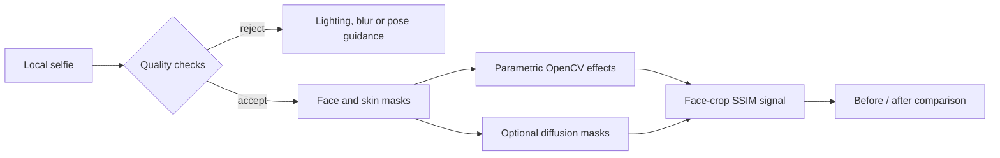

# Local aesthetic treatment previewer

A local Streamlit proof of concept for exploring subtle visual changes to a selfie. It performs image-quality checks, builds face-region masks, applies configurable OpenCV effects, and compares the preview with the original.

This is an illustrative imaging project—not a diagnostic system, treatment recommendation, medical device or prediction of clinical results.

## Processing flow



Images are processed by the local application. The core path does not require a cloud image API. Optional diffusion support may download model weights from the configured model source.

## Implemented previews

The default path uses non-generative image processing:

- edge-preserving wrinkle smoothing inside the skin mask;
- tone evening through luminance adjustment;
- gentle pigmentation contrast reduction;
- localized lip and under-eye warps.

An optional SDXL inpainting path is available behind separate ML dependencies and explicit UI controls. A geometric warp and generative inpainting are different techniques; neither should be described as a medically accurate outcome simulation.

## Quality and identity checks

The pipeline checks face presence, blur, lighting and approximate head roll before applying effects. MediaPipe landmarks are used when available; otherwise the application falls back to OpenCV Haar detection with a coarser bounding-box mask.

SSIM over the face crop is reported as a structural-similarity signal. It is not biometric identity verification and does not establish that a generated face is clinically or personally equivalent.

## Run locally

Create a Python environment and install the CPU-oriented core dependencies:

```bash
python -m venv .venv
source .venv/bin/activate
pip install -r requirements.txt
streamlit run app.py
```

On Windows PowerShell, activate with `.venv\Scripts\Activate.ps1`.

Optional landmark support:

```bash
pip install mediapipe==0.10.9
```

Optional diffusion support is substantially heavier and is better suited to compatible GPU or Apple Silicon environments:

```bash
pip install -r requirements-ml.txt
```

These commands were reviewed from the repository but not executed during the portfolio pass. Keep uploaded images synthetic or expressly permitted, especially when demonstrating the project publicly.

## Architecture

| Module | Responsibility |
|---|---|
| `app.py` | Streamlit controls and comparison view |
| `src/pipeline.py` | QC, masking, effects and result orchestration |
| `src/qc.py` | Blur, pose and lighting checks |
| `src/face_utils.py` | Face detection, landmarks and skin masks |
| `src/effects.py` | Parametric skin effects |
| `src/segmentation.py` | Lip and under-eye regions |
| `src/diffusion.py` | Lazy optional inpainting adapter |

## Tests

```bash
pytest
```

Test source covers QC behavior, face utilities, parametric effects and the diffusion boundary. The portfolio review inspected these tests statically but did not execute them. Automated image tests do not establish realism, medical validity, fairness across skin tones or identity preservation.

## Boundaries and responsible use

- Output is illustrative and must not be used for diagnosis or treatment decisions.
- Results depend on lighting, pose, camera processing and detector quality.
- The Haar fallback provides less precise masks than landmark detection.
- SSIM is a simple structural metric, not a safety guarantee.
- Diffusion can introduce details that were not present in the source image.
- Public examples should use synthetic, licensed or explicitly consented images with identifying metadata removed.

## Useful next work

Representative evaluation across lighting and skin tones, explicit consent/deletion controls, artifact detection, calibrated QC thresholds and a synthetic before/after gallery would strengthen the project more than adding more treatment labels.

## License

MIT. See `LICENSE`.
