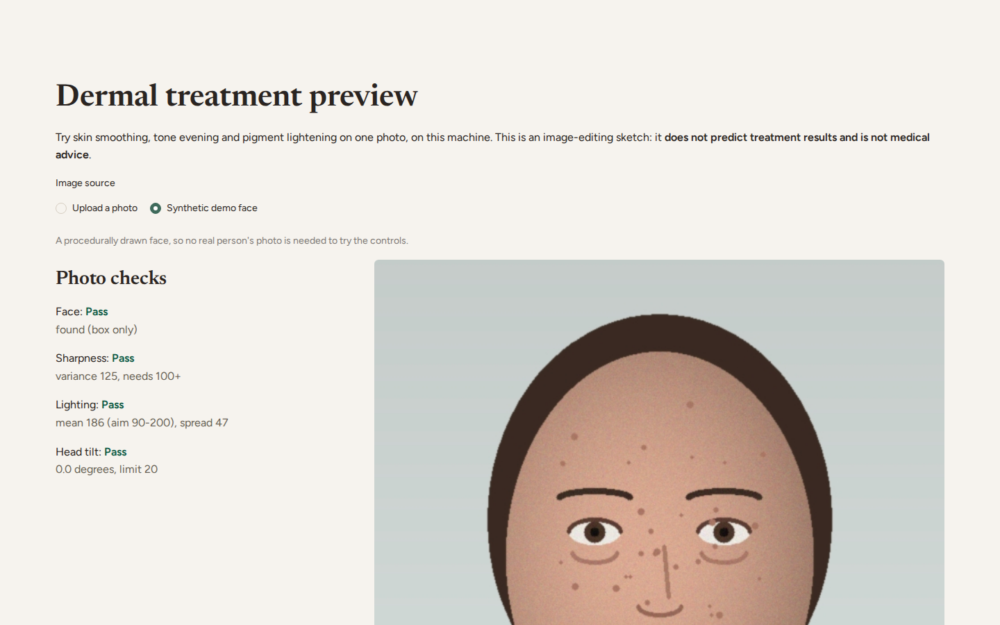
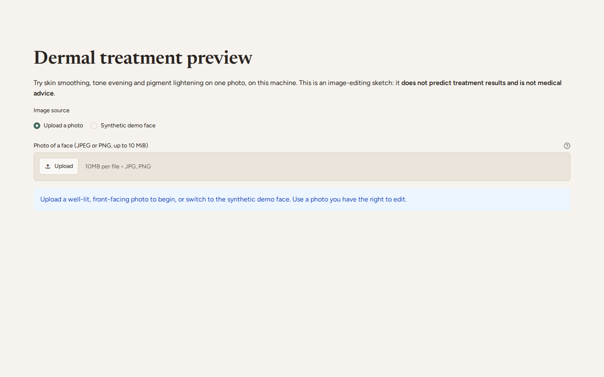
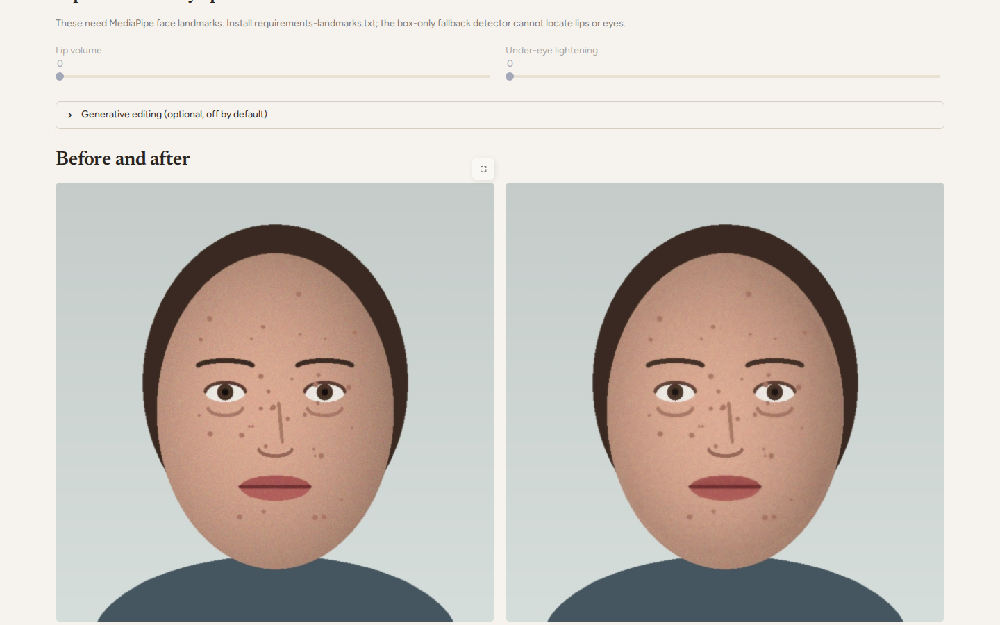
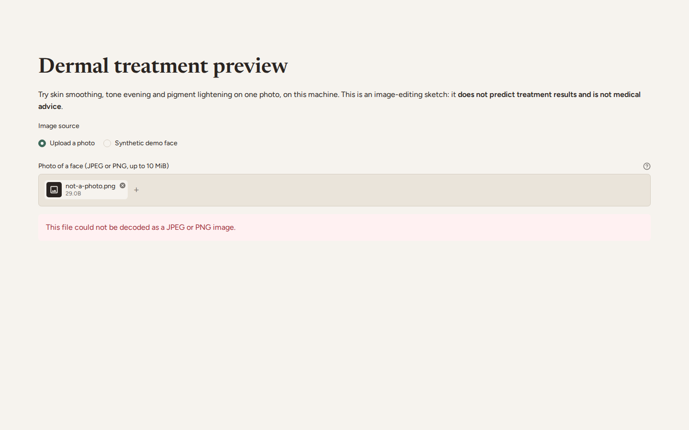
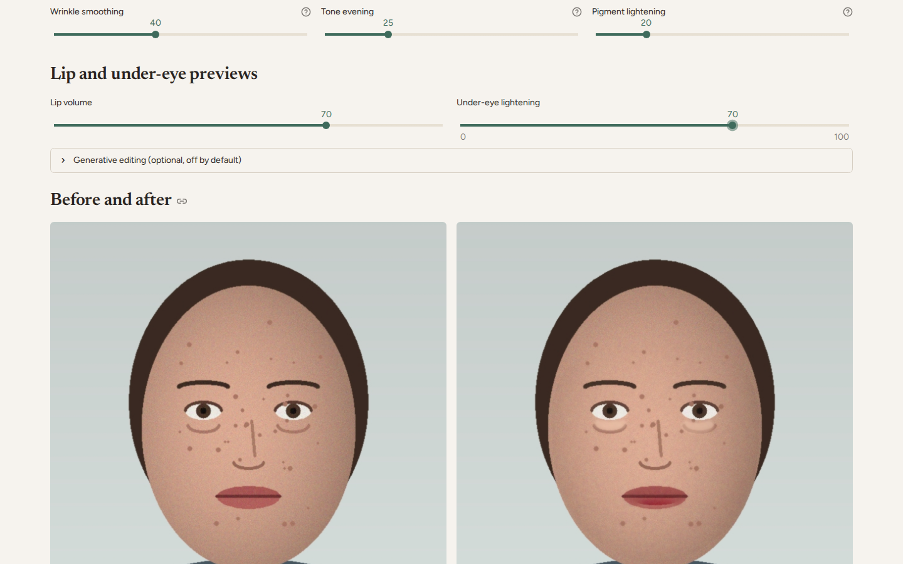

# Dermal treatment preview

A local Streamlit sketch for trying cosmetic-style skin adjustments on a single photo: wrinkle smoothing, tone evening and pigment lightening across the face, plus lip-volume and under-eye previews when MediaPipe landmarks are available. Everything runs on your machine with classical OpenCV and scikit-image operations; an optional SDXL inpainting path can use model weights you have already cached.

**This is an image-editing experiment, not medical advice.** It does not predict what a real treatment would do, does not assess whether anyone is suitable for one, and does not verify identity. The sliders move pixels; there is no physiological or clinical model behind them.



Every screenshot uses the built-in synthetic demo face, a procedurally drawn cartoon (`src/demo_face.py`). No real person's photo appears in this repository, its tests or its images.

| | |
| --- | --- |
|  |  |
|  |  |

On a phone the columns stack: [empty state](docs/screenshots/05-mobile-empty.png), [before and after](docs/screenshots/06-mobile-before-after.png).

## What it does

1. **Bounded upload.** JPEG or PNG only, at most 10 MiB and 20 million pixels, checked from the file header before decoding. EXIF orientation is applied and the long side is capped at 1,280 px. Unreadable files get an error message, not a stack trace.
2. **Photo checks.** A face must be found (MediaPipe FaceMesh if installed, otherwise OpenCV's Haar cascade), the image must be sharp enough (variance of the Laplacian), evenly lit, and the head not tilted more than 20 degrees. You can choose to edit anyway when a check fails. Checks run once per image, not on every slider move.
3. **Skin adjustments** inside a face mask: a bilateral filter for smoothing, CLAHE on lightness for tone, and a local lift of darker-than-surrounding pixels for pigment.
4. **Lip and under-eye previews** (landmarks only): a piecewise-affine warp around the lip ring with a seamless clone, and a feathered lightening of the skin below each lower lid, with the eye opening itself excluded.
5. **Before/after with a structural similarity score** (SSIM on the face crop) and a PNG download. SSIM measures how much pixel structure changed; it is not an identity check.


## Run it

### With Docker

```sh
docker build -t dermal-preview .
docker run --rm -p 127.0.0.1:8501:8501 dermal-preview
```

Open http://127.0.0.1:8501 and pick **Synthetic demo face**, or upload a photo you have the right to edit.

### With a local Python 3.12 environment

```sh
python3.12 -m venv .venv
source .venv/bin/activate
pip install -r requirements.txt
streamlit run app.py
```

`.streamlit/config.toml` binds the server to 127.0.0.1, caps uploads at 10 MiB, turns off usage statistics and sets the theme. The headings and body text use Newsreader and Figtree from Google Fonts and fall back to system fonts offline.

### Optional: landmarks for lip and under-eye previews

Without MediaPipe, the Haar detector only gives a face box, so the lip and under-eye sliders stay disabled. To enable them, install `requirements-landmarks.txt` **instead of** `requirements.txt`:

```sh
docker build --build-arg REQUIREMENTS=requirements-landmarks.txt -t dermal-preview:landmarks .
docker run --rm -p 127.0.0.1:8501:8501 dermal-preview:landmarks
```

It is a separate set because MediaPipe 1.x removed the FaceMesh API this app uses, and the last 0.10.x release needs protobuf 4 and NumPy 1. That caps Streamlit at 1.60 and Pillow at 12.3, which carry known advisories that the core set does not (see [Dependencies](#dependencies)). MediaPipe also brings a GUI build of OpenCV, which needs libGL; the Dockerfile installs it when building this variant.

### Optional: generative editing

Generation is off by default and nothing is ever downloaded: the pipeline loads with `local_files_only=True`. To try it, install `requirements-ml.txt` (CPU wheels via `--extra-index-url https://download.pytorch.org/whl/cpu`), put a compatible SDXL inpainting model (`diffusers/stable-diffusion-xl-1.0-inpainting-0.1` by default, see `src/config.py`) in your Hugging Face cache under its own licence, and turn on **Use generative editing**. If the packages or weights are missing, the app says so and uses the classical effects.

This path has not been run against real weights here. Its tests replace the model with a fake that returns a solid colour, which checks the region-of-interest crop, resizing, compositing and lazy loading, not image quality.

## Tests and lint

```sh
docker build --build-arg REQUIREMENTS=requirements-dev.txt -t dermal-preview:dev .
docker run --rm --network none dermal-preview:dev python -m pytest
docker run --rm --network none dermal-preview:dev ruff check .
```

Or locally: `pip install -r requirements-dev.txt && python -m pytest && ruff check . && ruff format --check .`

The suite uses synthetic arrays, the drawn demo face and fake model objects:

- upload decoding limits, EXIF handling and rejection messages;
- QC checks, masks, effects and the SSIM guard;
- SDXL compositing with a fake pipeline, including masks thinner than the downscaled region of interest;
- fallback from a failed generative edit back to the unedited image;
- the Streamlit page itself through `streamlit.testing` (empty state, demo face, disabled controls, zero-intensity edits);
- the installed Streamlit/Starlette pair still serving compressible images (see the Starlette note below).

`tests/test_landmarks.py` and one page test need MediaPipe and are skipped without it. They run against FaceMesh's real 478-point output on the demo face, and check that the lip warp stays around the mouth and that under-eye lightening leaves the eyes alone and adds no green cast:

```sh
docker run --rm --network none dermal-preview:landmarks sh -c "pip install pytest && python -m pytest"
```

## Design notes and limits

- **Masks are approximations.** The face mask is a convex hull of the landmarks (or an ellipse in the Haar box), so it includes eyes, brows and lips. It is not skin segmentation.
- **The Haar fallback cannot measure tilt.** It reports 0 degrees, so the orientation check always passes on that path.
- **Uploads stay in memory.** The app writes no files, but Streamlit holds the upload and the session's results in server memory. Keep the server bound to localhost.
- **SSIM is not identity.** The helper is still called `compute_identity_similarity` for compatibility; its output is labelled as structural similarity everywhere it is shown.
- There is no clinical evaluation, demographic performance analysis or measured accuracy of any kind.

## Dependencies

| Set | File | Notes |
| --- | --- | --- |
| Core | `requirements.txt` | Streamlit 1.67, NumPy 2.5, OpenCV 4.14 (headless), scikit-image 0.26, Pillow 13. `pip-audit` reports no known vulnerabilities. OpenCV 5 is not used because it moved `CascadeClassifier` out of the main package. |
| Dev | `requirements-dev.txt` | Core plus pytest and ruff. |
| Landmarks | `requirements-landmarks.txt` | Standalone: MediaPipe 0.10.18, Streamlit 1.60, NumPy 1.26, Pillow 12.3, opencv-contrib 4.11, Starlette 1.7. Pillow 12.3 and protobuf 4.25 have published advisories that are fixed only in versions MediaPipe 0.10.x cannot use. Starlette is held at 1.7 because Streamlit 1.60's gzip middleware breaks on 1.8+ and every image then fails with HTTP 500. |
| Generative | `requirements-ml.txt` | Core plus torch 2.15, diffusers 0.42, transformers 5.22, accelerate 1.15, safetensors 0.8. |

## Licence

MIT; see [LICENSE](LICENSE).
