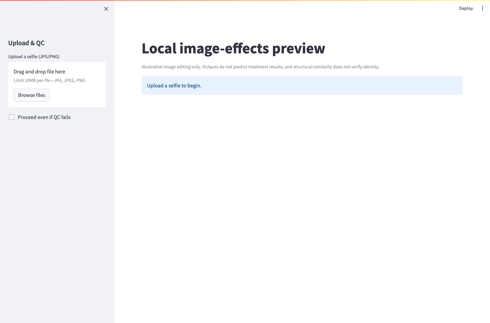

# Local image-effects preview

A Streamlit proof of concept for exploring masked image adjustments and optional inpainting. The main path uses OpenCV and approximate face regions; optional MediaPipe landmarks enable lip/under-eye regions, and an optional SDXL path can use already cached model weights.

This is an image-editing experiment. It does not predict treatment outcomes, assess medical suitability, or verify biometric identity. The previous “identity safety” wording was removed: SSIM is a structural image-similarity measure, as described by its [original authors](https://ece.uwaterloo.ca/~z70wang/research/ssim/), and no identity-validation study is included here.



[Mobile upload view](docs/upload-mobile.png) and [synthetic non-face QC example](docs/synthetic-qc.png) show only the local interface and a generated color texture. No person's face appears in these previews. A real Chrome session verified startup, invalid-image feedback, non-face rejection, no displayed application exceptions, and no document overflow at 390px. Third-party browser requests were blocked and usage telemetry was disabled for verification.

## Run the core app

Use Python 3.11 in a separate environment:

```sh
python3 -m venv .venv
source .venv/bin/activate
pip install -r requirements.txt
streamlit run app.py --server.address 127.0.0.1 --server.maxUploadSize 10 --browser.gatherUsageStats false
```

Core requirements keep the existing Streamlit 1.30 / NumPy 1.26 / OpenCV 4.8 pins. Duplicate unpinned entries were removed. Arrow 18.1 is pinned because a newer Arrow wheel required NumPy 2 and prevented this environment from starting. MediaPipe is now actually optional, via `requirements-landmarks.txt`, rather than being required by the core file while the README called it optional.

Uploads must be decoded JPEG/PNG, at most 10 MiB and 20 million pixels. EXIF orientation is applied, processing is resized to a maximum side of 1,280 pixels, and invalid images show a recoverable error. The application does not explicitly write uploaded images to its own files; Streamlit still holds session/upload data in memory. Keep the server local and use synthetic images for demonstrations.

## Processing path


The fallback Haar detector provides a bounding box, not reliable face-mesh geometry or roll estimation. The ellipse/convex-hull masks approximate a region; they are not semantic skin segmentation and can include features. The controls alter pixels, not a physiological model. No before/after treatment guarantee follows from a smooth-looking result.

## Optional generation

Generation starts **off**. Install `requirements-ml.txt` only when you intend to review/run the heavy optional stack, and provision a compatible model separately under its own terms. `from_pretrained` now uses `local_files_only=True`: this application will not automatically download missing weights. Missing dependencies/cache entries show an explicit non-generative fallback message. Empty masks return without initializing a model.

No Torch, diffusion dependencies, MediaPipe, model weights, or real selfies were installed/used in this review. GPU/MPS behavior, model licensing/provisioning, generative quality, and landmark accuracy remain unverified. The existing cached pipeline is process-wide and does not provide a multi-model serving architecture.

## Verification

```sh
pip install pytest
python -m pytest -q
```

Thirteen tests pass in an isolated environment matching the core pins. They cover QC, masks, output shape/type, zero-intensity effects, fake-model ROI compositing, empty-mask lazy loading, cached-weight enforcement, and an edge-pixel ROI boundary. Tests use synthetic NumPy arrays and fake model objects, not model inference. An original coincident-point lip fixture could not produce the nonempty ring it asserted; distinct inner/outer ellipses now test the ring, and a separate test verifies the degenerate case stays empty.

The historical helper name `compute_identity_similarity` remains for compatibility, but its output is labelled structural similarity. It can return zero when the selected crop cannot be compared; that is not a reliable identity decision. There is no clinical evaluation, demographic performance analysis, or measured treatment accuracy.

MIT license retained; see [LICENSE](LICENSE).
